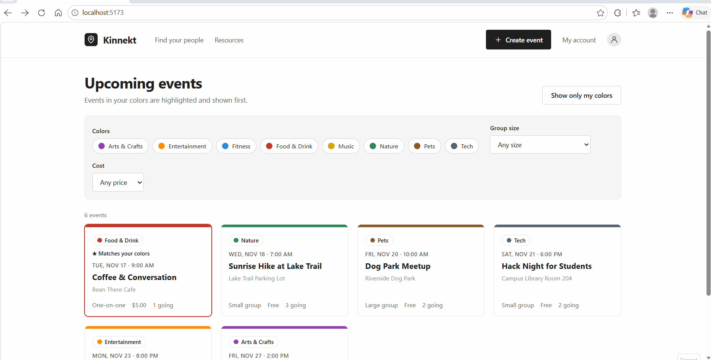
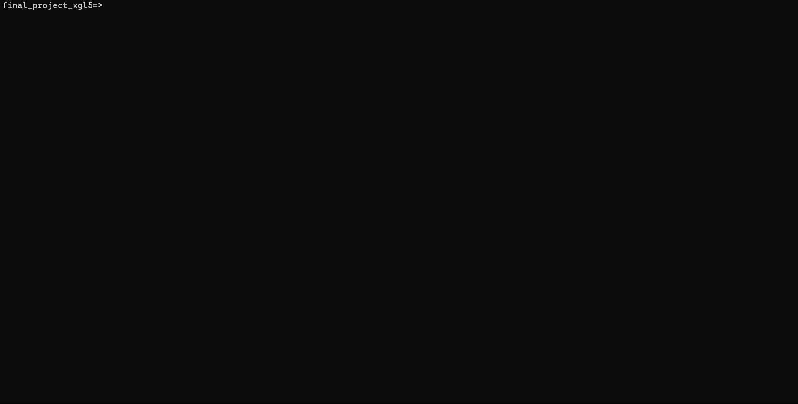
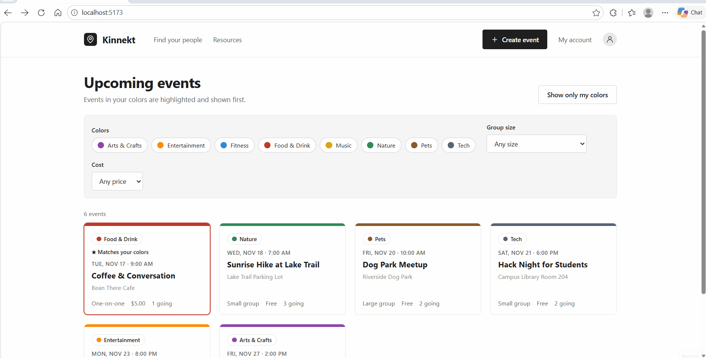
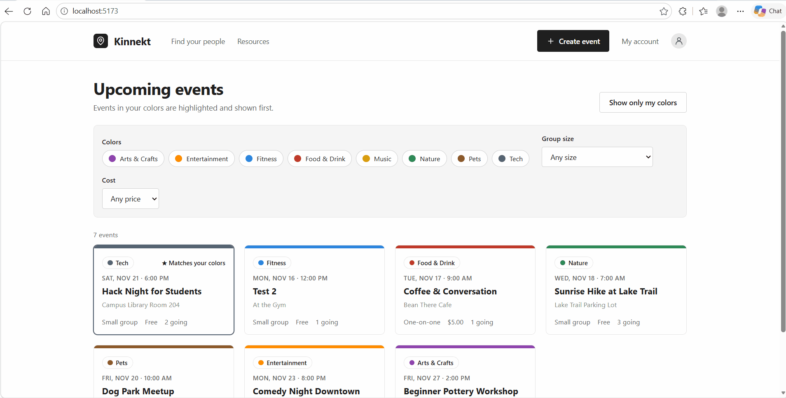

# Kinnekt

CodePath WEB103 Final Project

Designed and developed by: Bhupinder Mehton, Tabitha Sulaiman, and Jimmy Wu

🔗 Link to deployed app:

## About

### Description and Purpose

App for people who want to meet others and attend local events in their local communities.
We want to grow communities and allow individuals to create meaningful connections with each other.

### Inspiration

Instagram/Tinder, Eventbrite, Meetup

## Tech Stack

Frontend: React

Backend: Node.js, Express, Postgresql

## Features

### Interest color picker

Users choose the colors that represent what they enjoy (Green: Nature, Brown: Pets, Orange: Entertainment, and so on). The names always appear next to the colors, and the choices personalize what they see across the app.


### Create, edit, and cancel events

Organizers fill out a form with title, description, date, location, color category, group size, and cost. They can edit it later or delete it after a confirmation prompt. Past dates are rejected, and after creating an event the organizer is redirected to its page.




### Event details and RSVP pop-up

A dynamic page at /events/:eventId shows the full details and who is going, maybe going, or not going. A modal lets attendees RSVP with their name and email and change their status later without creating a duplicate.


### Resource finder

A page lists local resources in categories such as Student Housing, Jobs, Study Spots, and Recovery Programs, each with a cost level. Users can filter by category and cost, so a low-income family can sort by cheapest and someone displaced can open the recovery programs.



### Find your people

Users filter by life stage (new to town, recent grad, student, relocating) and see events and community members who share their colors, so newcomers can find others like them quickly.



### Browse and filter events

The home page shows upcoming events as cards with colored category badges. Users can filter by color, group size (small group or one-on-one vs. large), and cost (free or low-cost), and events that match their chosen colors are highlighted.

[gif goes here]

<!--
### [ADDITIONAL FEATURES GO HERE - ADD ALL FEATURES HERE IN THE FORMAT ABOVE; you will check these off and add gifs as you complete them] -->

## Installation Instructions

### What you need

- [Node.js](https://nodejs.org/) 20 or newer (check with `node -v`)
- A PostgreSQL database. We use a free one on [Render](https://render.com/). A local PostgreSQL install also works.

### 1. Get the code

```bash
git clone <this repo's URL>
cd web103_finalproject/Kinnekt
```

All commands below are run from the `Kinnekt` folder.

### 2. Install packages

```bash
npm run install-all
```

This installs packages for the root folder, `client/` (React), and `server/` (Express) in one step.

### 3. Connect the database

Copy `server/.env.example` to `server/.env` and fill in your database details. On Render, they are under your database's **Connections** section.

```
PGUSER=your_user
PGPASSWORD=your_password
PGHOST=your_host.oregon-postgres.render.com
PGPORT=5432
PGDATABASE=your_database
```

`server/.env` holds passwords, so it is git-ignored. Never commit it. Share the values with teammates privately.

> Using a local PostgreSQL instead? Set `PGHOST=localhost`. SSL is turned off automatically for localhost.

### 4. Create the tables and sample data

```bash
npm run reset
```

This drops and recreates every table, then loads sample people, events, and resources. **It deletes all existing data**, so only run it when you want a fresh start. Everyone sharing the same Render database shares the same data.

### 5. Start the app

```bash
npm run dev
```

This starts both apps together:

| What                 | Where                                                                                   |
| -------------------- | --------------------------------------------------------------------------------------- |
| React app (use this) | http://localhost:5173                                                                   |
| Express API          | http://localhost:3000. Open http://localhost:3000/api for a list of every API endpoint. |

Vite forwards every `/api` request from the React app to the Express server, so both must be running.

There is no login yet. Choose a sample person from **Viewing as** in the top bar, or create a profile on **My account**. Use **Log out** on the account page to switch people.

### Scripts

| Command               | What it does                                                 |
| --------------------- | ------------------------------------------------------------ |
| `npm run install-all` | Install packages for root, client, and server                |
| `npm run dev`         | Run the React app and the API together, with reloading       |
| `npm run reset`       | Recreate the database tables with sample data                |
| `npm run build`       | Build the React app into `server/public`                     |
| `npm start`           | Run the API server only (serves the built app in production) |

### Project structure

```
Kinnekt/
├── client/                 React app (Vite)
│   └── src/
│       ├── pages/          One component per route (they load the data)
│       ├── components/     Reusable pieces (cards, forms, modal, filters)
│       ├── services/       All fetch calls to the API, one file per resource
│       ├── context/        The current user ("Viewing as")
│       └── utils/          Formatting helpers
└── server/                 Express API
    ├── config/             Database connection and reset script
    ├── controllers/        Route logic and SQL queries
    ├── routes/             URL → controller mapping
    ├── data/seed.js        Sample data used by `npm run reset`
    └── index.html          API overview page
```

### Troubleshooting

- **`[vite] http proxy error: /api/...`**: the Express server isn't running or crashed. Look in the terminal for the `[1]` lines (the server's output) above `[nodemon] app crashed`. Fix the error and save any file to restart it.
- **`password authentication failed` or `getaddrinfo ENOTFOUND`**: check the values in `server/.env`.
- **`relation "events" does not exist`**: the tables haven't been created yet. Run `npm run reset`.
- **`EADDRINUSE: address already in use :::3000`**: another server is already running. Close the other terminal, or set `PORT=3001` in `server/.env` and change the proxy `target` in `client/vite.config.js` to match.
